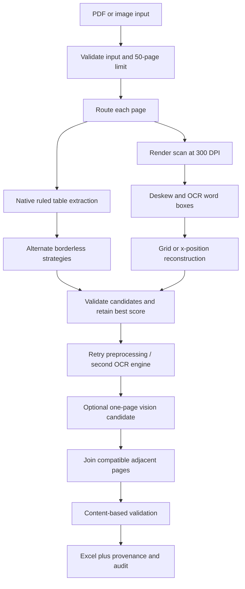

# Truecell

Convert digital PDFs and scanned documents into Excel with source provenance, explicit uncertainty, and content-based validation. Built independently for the INCUXAI AI Agent Development Challenge 2026. All included documents contain dummy data.

## Quick start

Use **64-bit Python 3.10, 3.11 or 3.12**. Python must be on PATH.

```sh
python -m venv .venv
# Windows PowerShell:
.venv\Scripts\Activate.ps1
# Linux / macOS instead: source .venv/bin/activate
pip install -r requirements.txt
python run.py
```

The browser opens at **http://127.0.0.1:8501**. Choose a document, convert, inspect findings, download the workbook. The server binds to your computer only. For CLI conversion:

```sh
python convert.py samples/A_invoice_register.pdf -o outputs/invoices.xlsx --audit-json outputs/invoices.audit.json
```

Installation needs internet; the default conversion path works offline on CPU. RapidOCR's ONNX models are bundled with its package, so first conversion does not need a model download. Optional Tesseract is discovered automatically, including `C:\Program Files\Tesseract-OCR` on Windows. On Linux/macOS install the `tesseract-ocr` / `tesseract` system package if a second OCR engine is desired. English OCR is the tested baseline. No API key is required.

If Windows reports a certificate error during installation, try `python -m pip install --use-feature=truststore -r requirements.txt` with your organization's trusted Windows certificate configuration. Do not disable certificate verification.

## What the workbook contains

- **Data 1, Data 2, ...**: one sheet per joined table; typed unambiguous numbers and dates. Leading zeros, identifiers longer than 15 digits, ambiguous dates and uncertain numeric notation remain text.
- **Validation Report**: severity, source page, source table data row, column, reason and suggested action. Yellow cells mark findings. Values are not corrected automatically.
- **Page Audit**: engine, strategy, selection, measured time, recovered cells and failures for each attempt. Confidence is an extraction heuristic or OCR score, not a calibrated accuracy probability.
- **Provenance**: output row to source page and table data row, including both fragments of an inferred split record.
- **Read me**: source, runtime and interpretation notes.

Source text beginning with `=` is explicitly stored as text in every sheet. Excel never executes source strings as formulas. Genuine duplicate business rows are **retained** and flagged. Detected repeated headers are not emitted as data. Ambiguous first rows are kept under generic column labels.

## Architecture



`truecell/router.py`, `digital.py`, `ocr.py`, `table.py`, `stitch.py`, `validate.py`, `recover.py`, `llm_repair.py`, `export.py` implement separate stages. `pipeline.py` orchestrates page-local attempts. The source PDF stays open while only the current page's raster and extraction caches are processed. Extracted rows and audit records accumulate for workbook creation.

## Requirements and evidence

| Challenge requirement | Implementation | Reproducible evidence |
|---|---|---|
| Up to 50 pages | Input guard before extraction; per-page rendering | `D_stress_50pages`: 800 data rows |
| 10+ columns | Dynamic grid widths, no fixed invoice schema | A and C: 12 columns |
| Scanned PDFs and images | RapidOCR ONNX; optional Tesseract; PNG/JPEG/TIFF/BMP/WebP | C and degradation cases |
| Detect tables and headers | Native line/text strategies; image grid geometry; content transitions | Borderless, merged header and two-table cases |
| Join multi-page tables | Adjacent-page geometry and header checks; headerless joins flagged | A, headerless, split-row cases |
| Validate data | Decimal sums, inferred arithmetic and running balances, structural/OCR checks | B includes wrong total and altered balance under opaque headers |

This table identifies implementation and test cases, not a claim that every case passes. See [the measured accuracy report](reports/ACCURACY_REPORT.md).

## Validation and recovery

Column types come from cell contents. Total keywords are matched in any cell. Subtotals use the preceding block; grand totals exclude subtotal rows. Decimal comparisons use half a unit of the least precise displayed decimal place. Running-balance discovery searches previous balance minus one numeric column plus another. Row arithmetic searches `a*b=c` and `a+b=c` across at least five varied rows with at least 80% agreement. Inferred discrepancies are findings, never silent edits. Short or heterogeneous data may provide insufficient evidence.

Additional checks identify ragged rows, empty columns, sparse rows, type mismatches, duplicate rows, inconsistent/ambiguous date formats, low OCR confidence, confusable numeric characters and repeated decimal separators. Candidate disagreements are reported even when the selected candidate passes arithmetic checks. A Tesseract retry can re-read low-confidence cells in isolation; every changed candidate value is logged with its old and new transcription and remains highlighted for source review.

Recovery tries native lines, then text and word alignment when needed. Scans try contrast/deskew, isolated cell rechecks or thresholding, dominant-table perspective rectification with illumination normalization, and an installed second OCR engine; very poor results may try right-angle rotation. Candidate scores reward whitespace-free character coverage and penalize false column fragmentation, generic headers and validation risks. Installed Tesseract is preferred for CPU throughput; bundled RapidOCR provides the portable fallback. Rendering targets 300 DPI, capped at 20 million pixels and 5500 pixels per side for unusually large pages. This is a heuristic; all attempts remain in the audit. A failed page is logged and remaining pages continue. An unreadable/corrupt/encrypted document, unsupported type or more than 50 pages produces a clear input error. CLI status: `0` workbook has tables, `2` input/output error, `3` no recovered tables. A zero status does not certify all pages or cells.

## Optional vision comparison

Only configured uncertain pages are sent to a network API. Set both `TRUECELL_LLM_API_KEY` and `TRUECELL_LLM_MODEL` to enable. `TRUECELL_LLM_ENDPOINT` optionally overrides the default HTTPS OpenAI Chat Completions endpoint. Choose an account-accessible model that supports image input and strict JSON-schema output. No model is selected or charged by default.

The request transcribes a **single page**, uses strict structured output, and validates response shape locally. Returned values compete as an audited candidate and differences are flagged. No original value is silently corrected. Refusal, timeout, invalid schema or provider errors degrade to the local result. Live provider behavior is not part of offline accuracy numbers. API implementation follows [official OpenAI structured-output documentation](https://developers.openai.com/api/docs/guides/structured-outputs?api-mode=chat).

## Reproduce evaluation

```sh
python -m eval.generate_samples --hard
python -m pytest -q
python scripts/judge_check.py
```

`samples/*.truth.json` and `*.truth.xlsx` hold intended cells independently of extraction. `outputs/*.xlsx` are converted workbooks, not ground truth. The scorer compares coordinates, table count, shape and headers and uses multiset row matching. PASS means exact canonicalized cells/headers/shape and all injected errors caught. Some hard cases may fail; judge_check returns nonzero if any exact case fails. It still writes every workbook and the full report. Synthetic development results must not be presented as independent hidden-test accuracy.

To evaluate a subset: `python -m eval.score --case A_invoice_register`. This rewrites the report with that subset; use judge_check to restore the full report. `requirements.txt` pins direct dependencies; `requirements-lock.txt` records the tested Python 3.11 Windows environment. Use the direct pins for cross-platform setup because transitive platform wheels differ.

## Limitations

No program can guarantee accurate conversion of *any* PDF. Handwriting, unusual scripts, complex merged body cells, strong perspective, deeply skewed/cropped scans, overlapping text, multiple borderless tables and ambiguous layout can fail. Headerless tables are joined by shape and span and need review. Split-row joining requires strong complementary fragments; ambiguous records remain separate. Numeric-only totals without labels are not reliably distinguished from ordinary data. Total vocabulary is English, not a general multilingual solution. Content-only arithmetic can infer coincidental relations. Native extraction and OCR can share mistakes; no clean validation result proves correctness. Review yellow cells and compare critical values with source pages.

## Submission contents

- Source code and tests in this repository.
- Dummy baseline and hard-case PDFs, ground-truth workbooks, converted workbooks, JSON audits.
- [Accuracy and validation report](reports/ACCURACY_REPORT.md).
- [Three-minute demo script](docs/DEMO_SCRIPT.md). Record the screen using this script for the required video; the script is not a recorded video.

To package source and samples: `python scripts/package_submission.py`. Review the report and record the video before submitting. The announcement's submission URL/contact fields are placeholders; obtain the real destination from the organizer.

## Credits and licensing

Original project-specific routing, stitching, validation, scoring and orchestration were written for this project. Libraries/models are credited in [THIRD_PARTY.md](THIRD_PARTY.md). PyMuPDF is AGPL/commercial dual licensed; consult its license before distributing a proprietary derivative. This repository's original code is released under AGPL-3.0-or-later to align with that dependency. No competitor source or personal documents are included.
