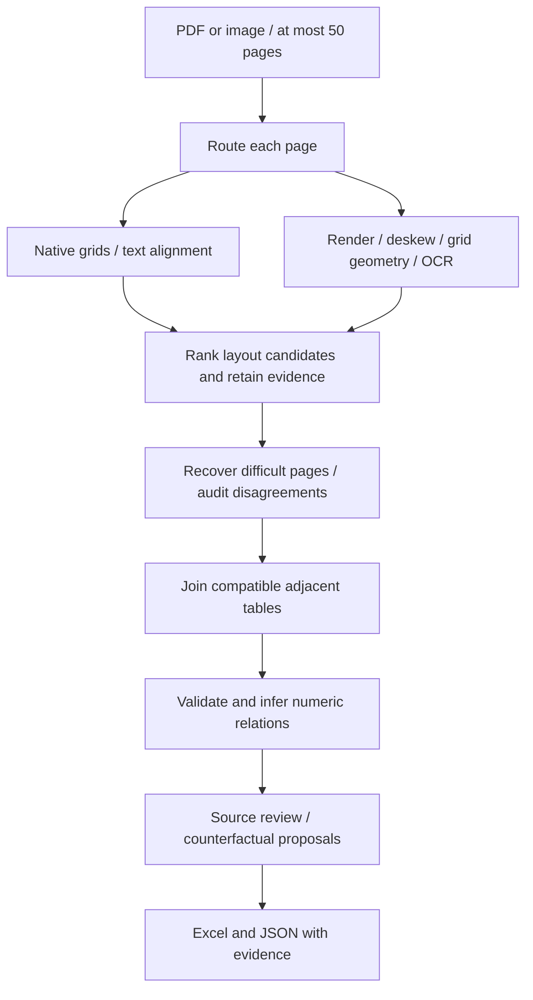

# Truecell Studio

**Document to Excel, with evidence.** An offline, CPU-based extraction and review application built for the INCUXAI AI Agent Development Challenge 2026. It reads digital PDFs and scans, reconstructs tables across pages, and exports data with source coordinates, validation findings, equation receipts and correction history. All included documents contain dummy data.

## Run it

Install **64-bit Python 3.10–3.12**, extract the complete project, and double-click **START_TRUECELL.cmd** on Windows. On Linux/macOS run `bash start.sh`. Initial setup creates a project-local environment and installs pinned dependencies; it needs internet. Subsequent conversion works offline, without an API key or GPU. Python 3.11 on Windows is the locally tested platform; other platforms/versions have a CI matrix but were not executed here.

```powershell
# Diagnose an existing Windows installation without network access
.\START_TRUECELL.cmd --check --offline
# Start using installed packages only
.\START_TRUECELL.cmd --offline
```

The launcher prints a localhost URL, normally **http://127.0.0.1:8501**, and chooses another port if occupied. It does not install system software. Manual setup:

```sh
python -m venv .venv
# Windows: .venv\Scripts\activate
# Linux/macOS: source .venv/bin/activate
python -m pip install --use-feature=truststore -r requirements.txt
python run.py
```

Direct dependencies are pinned in `requirements.txt`; `requirements-lock.txt` records the resolved Python 3.11 Windows environment. Use the direct pins for other platforms. Keep certificate verification enabled. The English recognition model ships in `models/` with a verified checksum. Detection/classification assets ship with RapidOCR's package; no conversion-time model download is needed. Optional Tesseract is discovered automatically, including its usual Windows installation directory.

## A three-minute first run

1. Click **Find a wrong balance**. The dummy bank table deliberately uses opaque column labels.
2. Open **Equation receipts**. The engine infers the running-balance relation from the values. At data row 11, printed `1081.00` conflicts with two adjacent balance equations; a proposal suggests `1064.00`.
3. Inspect the outlined original source cell. Click **Preview the effect without saving**: two failed equation checks become zero in a disposable copy. The original working value remains `1081.00`.
4. Apply a correction only after explicitly checking the source and entering a reason. The source reading and immutable original extraction remain available; the change appears in the history.
5. In **Review & export**, record a source-check attestation and download Excel with evidence. A later edit invalidates that review.

The source itself contains the wrong balance. Mathematical consistency alone does not establish the correct business value. Proposals are never applied automatically.

## What makes the result inspectable

| Capability | What it actually records |
|---|---|
| Cell source inspection | Original page, bounding box in page points, engine and original/alternate readings; outline on the source image |
| Independent reading | Optional local OCR of native pages; differences become findings rather than silent replacements |
| Equation receipts | Inferred row arithmetic and running balances, eligible rows, observed agreement and discrepancies |
| Counterfactual proposals | Candidate replacement, supporting equation instances, and preview of which checks would change |
| Review history | Before/after values, reason, UTC time and chained hashes; baseline extraction retained |
| Challenge lab | Up to 24 deterministic numeric perturbations in disposable copies, with headers hidden; detected and missed edits shown |
| Resumable workspaces | Local source copy, atomic JSON state and verified per-page checkpoints |

Counts of source boxes or equation agreement are **not extraction-accuracy probabilities**. The Challenge lab measures validation sensitivity on the current extraction, not OCR accuracy. For example, the invoice experiment detected 14 of 24 sampled edits; columns without inferred relations can miss errors entirely. Hashes detect changed snapshots and source bytes; they are not authenticated signatures or proof of reviewer identity.

Saved documents live in `outputs/jobs/` and are reopened from the sidebar. No cloud account is needed. Review status starts as **Unreviewed**. Marking a snapshot reviewed records a human attestation; unresolved findings can still exist. Local files are retained until you remove their workspace directory. Do not delete the only copy of an original document.

## Excel contents

| Sheet | Purpose |
|---|---|
| Data 1, Data 2, … | One sheet per joined table, typed unambiguous numbers/dates, source-evidence hyperlinks |
| Validation Report | Findings, source location, reason and suggested action |
| Page Audit | Every extraction attempt, selected strategy, timing and failure |
| Provenance | Row-to-page mapping, including both parts of split records |
| Read me | Interpretation and safety notes |
| Cell Evidence | Header/data source boxes, original readings and OCR scores where available |
| Verification | Source/snapshot hashes, review status and factual coverage counts |
| Constraints | Inferred formulas, checks, agreement and violation counts |
| Repair Proposals | Unapplied arithmetic suggestions and supporting equations |
| Correction History | Explicit human edits with reasons and integrity hashes |

Leading zeros and identifiers longer than 15 digits remain text. Percentages and unambiguous currency/grouped numbers are typed; ambiguous dates/numeric notation remain text. Source strings, including strings beginning `=`, are explicitly stored as text throughout the workbook. Source formulas are not executed. Genuine duplicate business rows are retained and flagged; detected repeating headers are removed. Uncertain structure and alternate readings remain review findings.

## Extraction approach



`pipeline.py` orchestrates independent modules for routing, extraction, geometry, alignment, stitching, validation, constraints, review, persistence and export. Native ruled geometry is preferred when structurally trustworthy; prose-heavy candidates cannot win merely by containing more characters. Borderless reconstruction uses stable numeric columns and separated horizontal streams. Multi-level headers retain their paths; inferred layout is flagged. Joining uses adjacency, headers, geometry and complementary split-row evidence; it never deduplicates business rows.

Scans use grid-aware cell recognition or word geometry, contrast/deskew, optional isolated rereads, illumination/perspective recovery and another installed engine when needed. Rendering targets 300 DPI with bounded dimensions. OCR boxes are mapped back through rotation/deskew/perspective transforms to the original page. Tesseract is preferred when installed for throughput; the bundled English RapidOCR recognizer supplies the portable route and independent rereads. These are heuristics; arbitrary damaged layouts can still fail.

Running balances and `a*b=c` / `a+b=c` relations are inferred from repeated numeric patterns rather than requiring financial header names. Discovery requires sufficient varied rows and majority agreement. Label-based totals, structural/type checks, empty or ragged columns, duplicates, OCR ambiguity and engine disagreements supplement these checks. Faithfully extracted source arithmetic errors do not trigger pointless OCR retries.

Only the current page raster and extraction caches are processed at a time; output rows/evidence accumulate for export. Completed-page checkpoints use JSON, never pickle, and bind to source bytes, code, runtime/package versions, model assets and extraction options. Changed/corrupt checkpoints are recomputed. Failed pages are logged and remaining pages continue. Input checks reject unsupported, corrupt, encrypted or oversized documents and more than 50 pages.

## CLI

```sh
python convert.py samples/A_invoice_register.pdf -o outputs/invoices.xlsx --audit-json outputs/invoices.audit.json
python convert.py samples/B_bank_errors.pdf -o outputs/bank.xlsx --verify --checkpoints outputs/checkpoints/bank
python convert.py scan.pdf -o outputs/scan.xlsx --force-ocr
```

`--verify` adds independent local OCR checks of native pages. `--force-ocr` helps with damaged text layers. `--no-recovery` limits extraction to the first strategy. Exit codes: `0` tables exported, `2` input/output error, `3` no recovered tables. Zero does not certify all cells/pages. Source, workbook and audit paths must differ.

Default conversion makes no API requests even when credentials exist. Optional vision comparison requires **both** explicit `--allow-cloud` and `TRUECELL_LLM_API_KEY` / `TRUECELL_LLM_MODEL`. `TRUECELL_LLM_ENDPOINT` can override the default HTTPS endpoint. Configure an image-capable model supporting strict JSON-schema output. Uncertain page images may then leave the computer. Results compete as audited candidates; refusals, schema errors and timeouts fall back locally. No provider credentials or live requests were used in these evaluation results. Reference: [OpenAI structured outputs](https://developers.openai.com/api/docs/guides/structured-outputs?api-mode=chat).

## Reproduce the evidence

```sh
python -m pytest -q
python scripts/judge_check.py
python scripts/portable_ocr_check.py
python scripts/public_audit.py --fetch
# After independently obtaining the published dummy samples:
python scripts/transfer_audit.py --fixtures PATH_TO_SAMPLES
# Optional development checks:
python -m pip install -r requirements-dev.txt
ruff check truecell tests eval scripts app.py convert.py run.py
ruff format --check truecell tests eval scripts app.py convert.py run.py
```

`python -m eval.generate_samples --hard` regenerates dummy inputs and truth. `samples/*.truth.json` / `*.truth.xlsx` hold intended values independently of extraction; `outputs/*.xlsx` are converted files. Strict scoring checks ordered coordinates, headers, table shapes/counts, multiset rows, and detection of annotated errors. Numeric formatting/whitespace are canonicalized while leading zeros are preserved. A subset run rewrites the accuracy report; `judge_check.py` restores all cases.

- [Development accuracy](reports/ACCURACY_REPORT.md): **13/13 exact cases**, including 12-column scans, blur/noise, skew, photo perspective, multi-table pages, split records and 50 pages / 800 rows. Both deliberate bank-source errors detected.
- [External layout audit](reports/EXTERNAL_AUDIT.md): full 35-cell fuel table; **48 selected** census cells plus all 16 headers and both shapes; no-table W3C control. Other 464 census cells were not independently checked.
- [Published fixture transfer audit](reports/TRANSFER_AUDIT.md): all cells/headers/shapes on three author-provided dummy fixtures. Only Truecell was executed; this is not a relative performance ranking.
- [Build verification](reports/BUILD_VERIFICATION.md): actual local tests, portability checks and unverified items.
- [Portable OCR check](reports/PORTABLE_OCR.json): all four synthetic scan cases passed with Tesseract excluded; the perspective-photo case took about 96 seconds for two pages.

All these inputs were used during development. None is a blind benchmark or promise of hidden-test accuracy. Reports preserve scope and failures rather than assigning an invented overall accuracy score.

## Limitations

Handwriting, untested scripts, unusual fonts or broken text-layer glyphs, nested merged body cells, overlapping text and severe crop/rotation/perspective can fail. Headerless joins and numeric alignment can confuse unrelated tables. Sparse/short data may not support arithmetic discovery; coincidental relations can generate false alarms. Numeric-only total rows are ambiguous, and English total vocabulary is limited. OCR engines can share mistakes. A clean validation report does not prove correct extraction. Compare important values with the original pages.

## Submission

Run `python scripts/package_submission.py` to create `submission/Truecell-Studio-source-and-samples.zip` with source, model/licence, tests, all 13 dummy PDF/truth/converted pairs, reports and launchers. Local environments, credentials, uploaded workspaces and temporary external fixtures are excluded. The previous v0.1 archive is kept separately.

[Demo script](docs/DEMO_SCRIPT.md) provides a 3–4 minute walkthrough. **A recorded video still needs to be made**; a script is not a video. Obtain the real submission URL/contact from the organizer because the announcement contains placeholders.

Original project-specific code was written independently with AI coding assistance. Libraries/models perform the underlying PDF/OCR work and are credited in [THIRD_PARTY.md](THIRD_PARTY.md). No competitor implementation is included. Original code is AGPL-3.0-or-later, consistent with PyMuPDF; preserve third-party notices.
