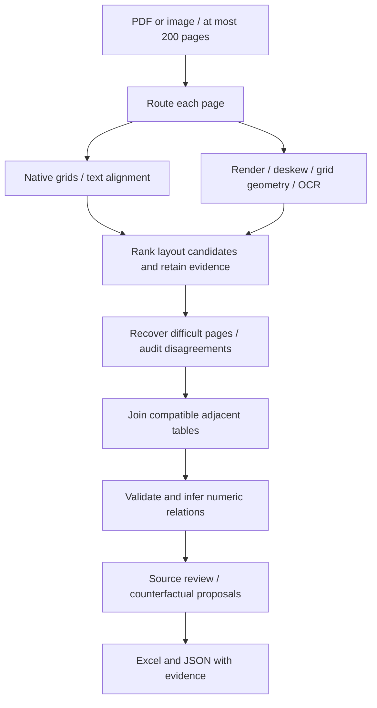

# Truecell

**Document Intelligence — Document to Excel, with evidence.** An offline, CPU-based extraction and review application built for the INCUXAI AI Agent Development Challenge 2026. It reads digital PDFs and scans, reconstructs tables across pages, and exports data with source coordinates, validation findings, equation receipts and correction history. A responsive React/TypeScript application is served locally by FastAPI. All included documents contain dummy data.

## Judge snapshot

- **21/21** deterministic development cases passed, including 50 pages / 800 rows, 18 columns, scans, difficult layouts and nested line items with ruled vertical spans.
- **203 Python tests** and **10 frontend tests** passed.
- **5/5 portable OCR cases** passed with Tesseract excluded.
- Every exported row retains page provenance; recovered cells can retain page coordinates, engine, reading and confidence evidence.

Start with [JUDGE_START_HERE.txt](JUDGE_START_HERE.txt), then inspect the [accuracy report](reports/ACCURACY_REPORT.md) and [build verification](reports/BUILD_VERIFICATION.md). These are disclosed development results, not hidden-document accuracy claims.

## Run it

Install **64-bit Python 3.10–3.12**, extract the complete project, and double-click **START_TRUECELL.cmd** on Windows. On Linux/macOS run `bash start.sh`. Initial setup creates a project-local environment and installs pinned dependencies; it needs internet. Subsequent conversion works offline, without an API key or GPU. Python 3.11 on Windows is the locally tested platform; other platforms/versions have a CI matrix but were not executed here.

```powershell
# Diagnose an existing Windows installation without network access
.\START_TRUECELL.cmd --check --offline
# Start using installed packages only
.\START_TRUECELL.cmd --offline
# Also allow a phone on the same private Wi-Fi network
.\START_TRUECELL.cmd --offline --lan
```

The one-command launcher prints a localhost URL, normally **http://127.0.0.1:8501**, and chooses another port if occupied. With `--lan`, it also prints an exact **Phone (same Wi-Fi)** URL; keep the terminal open and use that address on a phone connected to the same private network. Windows may ask permission for private-network access. Normal launches remain limited to this computer. The supplied production frontend is prebuilt, so judges do not need Node.js or internet after setup. It does not install system software. A direct `python run.py` launch uses its requested port and reports a clear error if that port is occupied. Manual setup:

```sh
python -m venv .venv
# Windows: .venv\Scripts\activate
# Linux/macOS: source .venv/bin/activate
python -m pip install --use-feature=truststore -r requirements.txt
python run.py
# Optional phone access on the same private Wi-Fi
python run.py --lan
```

Direct dependencies are pinned in `requirements.txt`; `requirements-lock.txt` records the resolved Python 3.11 Windows environment. Use the direct pins for other platforms. Keep certificate verification enabled. The English recognition model ships in `models/` with a verified checksum. Detection/classification assets ship with RapidOCR's package; no conversion-time model download is needed. Optional Tesseract is discovered automatically, including its usual Windows installation directory.

## A three-minute first run

1. Click **Find a wrong balance**. The dummy bank table deliberately uses opaque column labels.
2. Open **Equations** in the validation rail. The engine infers the running-balance relation from the values. At data row 11, printed `1081.00` conflicts with two adjacent balance equations; a proposal suggests `1064.00`.
3. Select the finding to open its evidence and outlined source cell. Use **Preview validation impact**: two failed equation checks become zero in a disposable copy. The original working value remains `1081.00`.
4. Apply a correction only after explicitly checking the source and entering a reason. The source reading and immutable original extraction remain available; the change appears in the history.
5. In the **Audit** rail, record a source check with **Record source check**, then use **Export Excel** in the top bar. A later edit invalidates that review.

Select any table cell or finding to focus its exact source evidence. The **Audit** rail preserves every extraction attempt, and source-page controls remain available even when no table is recovered. The **Challenge** rail runs controlled disposable mutations against the production validator. Additional examples demonstrate a sparse text schedule, a sideways invoice and page carry-forwards.

The source itself contains the wrong balance. Mathematical consistency alone does not establish the correct business value. Proposals are never applied automatically.

## What makes the result inspectable

| Capability | What it actually records |
|---|---|
| Cell source inspection | Original page, bounding box in page points, engine and original/alternate readings; outline on the source image |
| Independent reading | Optional local OCR of native pages; differences become findings rather than silent replacements |
| Equation receipts | Inferred row arithmetic and running balances, eligible rows, observed agreement and discrepancies |
| Counterfactual proposals | Candidate replacement, supporting equation instances, and preview of which checks would change |
| Review history | Before/after values, reason, UTC time and chained hashes; baseline extraction retained |
| Challenge lab | Up to 24 deterministic numeric perturbations in disposable copies, with headers hidden; detected and missed edits shown |
| Resumable workspaces | Local source copy, atomic JSON state and verified per-page checkpoints |

Counts of source boxes or equation agreement are **not extraction-accuracy probabilities**. The Challenge lab measures validation sensitivity on the current extraction, not OCR accuracy. For example, the invoice experiment detected 14 of 24 sampled edits; columns without inferred relations can miss errors entirely. Hashes detect changed snapshots and source bytes; they are not authenticated signatures or proof of reviewer identity.

Saved documents live in `outputs/jobs/` and are reopened from **Saved workspaces** in the top navigation. Use the trash icon beside a workspace and confirm **Delete workspace** to remove its local source, extraction, corrections and audit history; workspaces cannot be deleted while extraction is running. No cloud account is needed. Review status starts as **Unreviewed**. Marking a snapshot reviewed records a human attestation; unresolved findings can still exist. Do not delete the only copy of an original document.

Jobs with failed pages are marked **partial** and can resume completed-page checkpoints. Resuming a job that already has corrections or a source-review attestation opens a new workspace, preserving the existing working copy. A missing source page produces an inline error while the current result and downloads remain available. Review confirmations reset when the document or correction target changes.

## Excel contents

| Sheet | Purpose |
|---|---|
| Data 1, Data 2, … | One sheet per joined table, typed unambiguous numbers/dates, source-evidence hyperlinks |
| Validation Report | Findings, source location, reason and suggested action |
| Page Audit | Every extraction attempt, selected strategy, timing and failure |
| Provenance | Row-to-page mapping, including both parts of split records |
| Read me | Interpretation and safety notes |
| Cell Evidence | Header/data source boxes, original readings and OCR scores where available |
| Verification | Source/snapshot hashes, review status and factual coverage counts |
| Constraints | Inferred formulas, checks, agreement and violation counts |
| Repair Proposals | Unapplied arithmetic suggestions and supporting equations |
| Correction History | Explicit human edits with reasons and integrity hashes |
| Page Summaries (when present) | Original carry-forward lines with page/box evidence, kept outside transaction rows |

Leading zeros and identifiers longer than 15 digits remain text. Percentages and unambiguous currency/grouped numbers are typed; ambiguous dates/numeric notation remain text. Source strings, including strings beginning `=`, are explicitly stored as text throughout the workbook. Source formulas are not executed. Genuine duplicate business rows are retained and flagged; detected repeating headers are removed. Uncertain structure and alternate readings remain review findings.

Excel strings use a reversible escape convention for XML-forbidden characters and literal escape sequences, described in the workbook's **Read me** sheet. Literal backslashes are doubled; the original strings remain unchanged in the audit JSON. Values beyond Excel's cell-text limit have an explicit preview and complete numbered chunks in **Long Text**. Extremely small values that Excel cannot represent safely remain text, and small representable decimals use a format that does not display them as zero.

## Extraction approach



`pipeline.py` orchestrates independent modules for routing, extraction, geometry, alignment, stitching, validation, constraints, review, persistence and export. Native ruled geometry is preferred when structurally trustworthy; prose-heavy candidates cannot win merely by containing more characters. In native PDFs, an explicitly ruled label cell that vertically spans several body rows is conservatively expanded across those rows while every repeated value retains the original spanning cell's source box and is flagged for review. This supports nested line-item groups without using generic fill-down. Borderless reconstruction uses stable numeric columns and separated horizontal streams. Multi-level headers retain their paths; inferred layout is flagged. Joining uses adjacency, headers, geometry and complementary split-row evidence; it never deduplicates business rows.

Header-guided reconstruction also uses native font/whitespace evidence, or separated OCR labels followed by repeated numeric records. This preserves sparse columns and wrapped text. Nearby unruled invoice totals are retained with source boxes; page carry-forward summaries are retained separately. Plain native text with no table and no raster image does not automatically trigger OCR; use **Force OCR** for a damaged text layer. Rotation recovery checks layout uncertainty even when a wrong orientation produces many cells, and can cross-check the best rotated reading with another installed engine.

Scans use grid-aware cell recognition or word geometry, contrast/deskew, optional isolated rereads, illumination/perspective recovery and another installed engine when needed. Rendering targets 300 DPI with bounded dimensions. OCR boxes are mapped back through rotation/deskew/perspective transforms to the original page. Tesseract is preferred when installed for throughput; the bundled English RapidOCR recognizer supplies the portable route and independent rereads. These are heuristics; arbitrary damaged layouts can still fail.

Running balances and `a*b=c` / `a+b=c` relations are inferred from repeated numeric patterns rather than requiring financial header names. Discovery requires sufficient varied rows and majority agreement. Label-based totals, structural/type checks, empty or ragged columns, duplicates, OCR ambiguity and engine disagreements supplement these checks. Faithfully extracted source arithmetic errors do not trigger pointless OCR retries.

Only the current page raster and extraction caches are processed at a time; output rows/evidence accumulate for export. Completed-page checkpoints use JSON, never pickle, and bind to source bytes, code, runtime/package versions, model assets and extraction options. Changed/corrupt checkpoints are recomputed. Failed pages are logged and remaining pages continue. Input checks reject unsupported, corrupt, encrypted or oversized documents and more than 200 pages. The measured stress fixture remains 50 pages / 800 rows; the higher input ceiling is a runtime capability, not a 200-page accuracy claim.

## CLI

```sh
python convert.py samples/A_invoice_register.pdf -o outputs/invoices.xlsx --audit-json outputs/invoices.audit.json
python convert.py samples/B_bank_errors.pdf -o outputs/bank.xlsx --verify --checkpoints outputs/checkpoints/bank
python convert.py scan.pdf -o outputs/scan.xlsx --force-ocr
```

`--verify` adds independent local OCR checks of native pages. `--force-ocr` helps with damaged text layers. `--no-recovery` limits extraction to the first strategy. Exit codes: `0` tables exported, `2` input/output error, `3` no recovered tables. Zero does not certify all cells/pages. Source, workbook and audit paths must differ.

Default conversion makes no API requests even when credentials exist. Optional vision comparison requires **both** explicit `--allow-cloud` and `TRUECELL_LLM_API_KEY` / `TRUECELL_LLM_MODEL`. `TRUECELL_LLM_ENDPOINT` can override the default HTTPS endpoint. Configure an image-capable model supporting strict JSON-schema output. Uncertain page images may then leave the computer. Results compete as audited candidates; refusals, schema errors and timeouts fall back locally. No provider credentials or live requests were used in these evaluation results. Reference: [OpenAI structured outputs](https://developers.openai.com/api/docs/guides/structured-outputs?api-mode=chat).

## Reproduce the evidence

```sh
python -m pytest -q
python scripts/judge_check.py
python scripts/portable_ocr_check.py
python scripts/public_audit.py --fetch
npm --prefix frontend test
npm --prefix frontend run build
# After independently obtaining the published dummy samples:
python scripts/transfer_audit.py --fixtures PATH_TO_SAMPLES
# Optional development checks:
python -m pip install -r requirements-dev.txt
ruff check truecell tests eval scripts convert.py run.py
ruff format --check truecell tests eval scripts convert.py run.py
```

`python -m eval.generate_samples --hard` regenerates the original dummy inputs and truth. `python -m eval.generate_layouts` generates eight additional cases. `samples/*.truth.json` / `*.truth.xlsx` hold intended values independently of extraction; `outputs/*.xlsx` are converted files. Strict scoring checks ordered coordinates, headers, table shapes/counts, multiset rows, and detection of annotated errors. Numeric formatting/whitespace are canonicalized while leading zeros are preserved. No-table controls require zero output tables and report cell percentages as n/a. A subset run rewrites the accuracy report; `judge_check.py` restores all cases.

- [Development accuracy](reports/ACCURACY_REPORT.md): 21 dummy cases cover 12-column scans, 18-column borderless tables, explicitly ruled vertical group spans with nested line items, blur/noise, skew, photo perspective, sideways scans with unruled totals, sparse text matrices, wrapped addresses, carry-forwards, no-table controls, multi-table pages, split records and 50 pages / 800 rows. See the report for measured pass/fail results and both deliberately injected bank-source errors.
- [External layout audit](reports/EXTERNAL_AUDIT.md): full 35-cell fuel table; **48 selected** census cells plus all 16 headers and both shapes; no-table W3C control. Other 464 census cells were not independently checked.
- [Published fixture transfer audit](reports/TRANSFER_AUDIT.md): all cells/headers/shapes on three author-provided dummy fixtures. Only Truecell was executed; this is not a relative performance ranking.
- [Build verification](reports/BUILD_VERIFICATION.md): actual local tests, portability checks and unverified items.
- [Portable OCR check](reports/PORTABLE_OCR.json): five synthetic scan cases with Tesseract excluded, including the sideways invoice. See individual results and timing in the report.

All these inputs were used during development. None is a blind benchmark or promise of hidden-test accuracy. Reports preserve scope and failures rather than assigning an invented overall accuracy score.

## Limitations

Handwriting, untested scripts, unusual fonts or broken text-layer glyphs, overlapping text and severe crop/rotation/perspective can fail. Explicitly ruled vertical group spans in native-PDF body rows are supported conservatively; OCR/unruled spans and arbitrary multi-axis nested merges remain ambiguous. Headerless joins and numeric alignment can confuse unrelated tables. Sparse/short data may not support arithmetic discovery; coincidental relations can generate false alarms. Numeric-only total rows are ambiguous, and English total vocabulary is limited. OCR engines can share mistakes. A clean validation report does not prove correct extraction. Compare important values with the original pages.

## Submission

When ready, run `python scripts/package_submission.py` to create `submission/Truecell-source-and-samples.zip` with source, model/licence, tests, all 21 dummy PDF/truth/converted pairs, reports and launchers. Local environments, credentials, uploaded workspaces and temporary external fixtures are excluded. **The existing `Truecell-Studio-source-and-samples.zip` predates the current upgrades; it has intentionally not been rebuilt.**

[Demo script](docs/DEMO_SCRIPT.md) provides a 3–4 minute walkthrough. **A recorded video still needs to be made**; a script is not a video. Obtain the real submission URL/contact from the organizer because the announcement contains placeholders.

Original project-specific code was written independently with AI coding assistance. Libraries/models perform the underlying PDF/OCR work and are credited in [THIRD_PARTY.md](THIRD_PARTY.md). No competitor implementation is included. Original code is AGPL-3.0-or-later, consistent with PyMuPDF; preserve third-party notices.

## Folder guide

The outer `Truecell/` is the project directory. Its inner `truecell/` is the Python package containing the extraction engine and local API. `frontend/` contains the React/TypeScript source and prebuilt `dist/` assets; `eval/` generates/scores dummy documents; `samples/` holds PDFs and truth; `outputs/` holds converted workbooks and audit JSON; `tests/` checks behavior; `reports/` records measured results; `docs/` holds guidance; `models/` contains the credited OCR asset. `.venv/`, `frontend/node_modules/`, cache directories and `tmp/` are local development files. Competitor source and comparison materials are kept outside this project.
