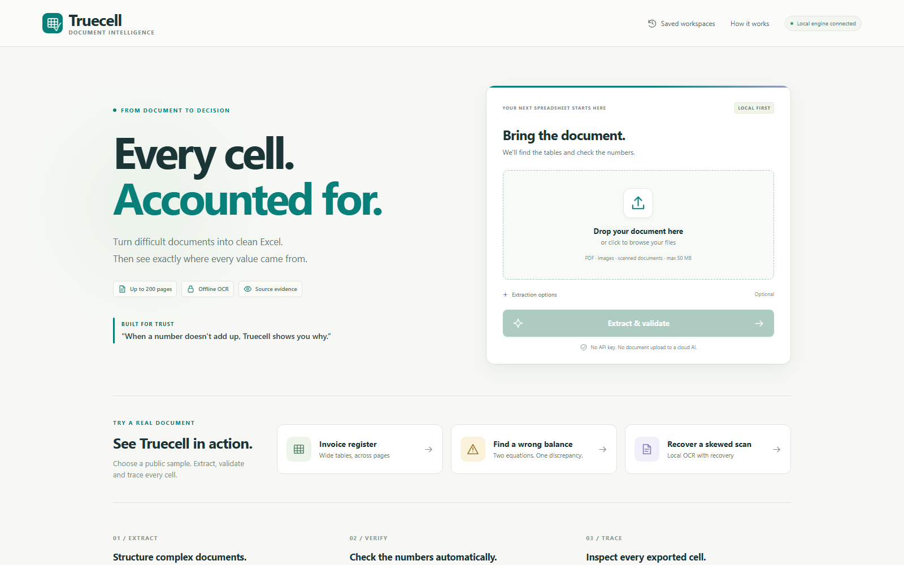
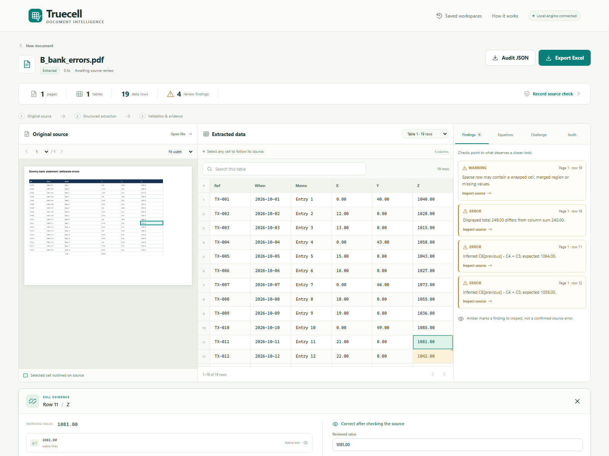
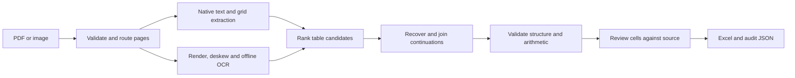

<p align="center">
  
</p>

<h1 align="center">Truecell</h1>

<p align="center">
  <strong>Every cell. Accounted for.</strong><br>
  <em>Turn PDFs and scans into validated Excel—with source evidence for every value.</em>
</p>

<p align="center">
  <a href="https://github.com/Pranay207/Truecell/actions/workflows/tests.yml"></a>
  
  
  
  
  <a href="LICENSE"></a>
</p>

Truecell is a local-first React and FastAPI application built for the **INCUXAI AI Agent Development Challenge 2026**. It detects tables, reconstructs difficult layouts, joins continuations across pages, checks numeric relationships, and exports reviewable Excel workbooks. Every retained value can carry its page, source box, extraction engine, original reading, and confidence evidence.



*Local-first upload and guided sample workflow.*



*Searchable extraction, source evidence, validation, and export in one review workspace.*

<details>
<summary>Mobile view (390 px)</summary>

<p align="center">
  
</p>

</details>

## Judge snapshot

| Verified result | Evidence |
|---|---|
| **21/21** deterministic development cases passed | [Accuracy report](reports/ACCURACY_REPORT.md) |
| **203** Python tests and **13** frontend tests passed | [Build verification](reports/BUILD_VERIFICATION.md) |
| **5/5** scan cases passed with Tesseract excluded | [Portable OCR results](reports/PORTABLE_OCR.json) |
| **50 pages / 800 rows / 12 columns** recovered in the measured stress fixture | [Stress PDF](samples/D_stress_50pages.pdf) · [Converted workbook](outputs/D_stress_50pages.xlsx) |
| **18-column** borderless table and vertically grouped nested line items passed exact checks | [18-column workbook](outputs/E_eighteen_columns.xlsx) · [Nested-lines workbook](outputs/E_vertical_nested_lines.xlsx) |

These are disclosed dummy development fixtures, not blind or hidden-document accuracy claims. Exact evaluation compares ordered cells, headers, table shapes, row multisets, and annotated errors. Start with [JUDGE_START_HERE.txt](JUDGE_START_HERE.txt) for the shortest review path.

## Competition evidence matrix

| Judging area | Truecell evidence |
|---|---|
| **OCR and extraction accuracy — 30** | Bundled offline RapidOCR, optional local Tesseract, native-PDF extraction, deskew/rotation/perspective recovery, cell-level source boxes, and **5/5** portable OCR fixtures without Tesseract. |
| **Multi-page and complex tables — 25** | Repeated-header removal, continuation joins, split-row recovery, page carry-forward separation, 18-column reconstruction, conservative vertically spanned group labels, and an exact **50-page / 800-row** stress result. |
| **Column alignment and data integrity — 20** | Header and geometry scoring, leading-zero preservation, typed unambiguous values, formula-injection protection, duplicate retention, row-to-page provenance, and exact shape/header checks. |
| **Automation and error recovery — 15** | Automatic page routing, alternate extraction strategies, failed-page continuation, verified JSON checkpoints, resumable partial jobs, inferred arithmetic checks, counterfactual repair previews, and explicit correction history. |
| **Code quality and usability — 10** | Responsive React/TypeScript UI, FastAPI backend, searchable extracted tables, source inspector, saved local workspaces, **203 Python + 13 frontend tests**, Ruff checks, and a 3-OS/3-Python CI matrix. |

## Run it in one command

Use **64-bit Python 3.10–3.12**. Python 3.11 on Windows is the locally tested platform.

```text
Windows:       double-click START_TRUECELL.cmd
Linux/macOS:   bash start.sh
```

The first run creates `.venv` and installs pinned dependencies, so it needs internet. Later runs and normal conversions work offline on CPU without an API key or GPU. The launcher opens a local URL, normally **http://127.0.0.1:8501**.

```powershell
# Verify an existing installation without network access
.\START_TRUECELL.cmd --check --offline

# Start using installed packages only
.\START_TRUECELL.cmd --offline

# Optional phone demo on the same private Wi-Fi
.\START_TRUECELL.cmd --offline --lan
```

The application accepts PDFs up to **200 pages**, multi-frame images/TIFFs up to **50 frames**, and uploads up to **50 MB**. The measured large-document fixture is 50 pages; the 200-page ceiling is an input capability, not a 200-page accuracy benchmark. The production frontend is prebuilt, so judges do not need Node.js.

<details>
<summary>Manual setup and CLI</summary>

```sh
python -m venv .venv
# Windows: .venv\Scripts\activate
# Linux/macOS: source .venv/bin/activate
python -m pip install --use-feature=truststore -r requirements.txt
python run.py
```

```sh
python convert.py samples/A_invoice_register.pdf -o outputs/demo.xlsx
python convert.py samples/B_bank_errors.pdf -o outputs/bank.xlsx --verify
python convert.py scan.pdf -o outputs/scan.xlsx --force-ocr
```

`--verify` runs an independent local OCR check on native pages. `--force-ocr` handles damaged text layers. `python run.py --lan` serves the app only to loopback and the detected private network while the process is running.

</details>

## Sample PDFs and converted Excel files

Every document below contains generated dummy data. The linked XLSX files are Truecell outputs; independent truth files remain beside the PDFs in `samples/`.

| Case | Input PDF | Converted Excel | What it proves |
|---|---|---|---|
| Invoice register | [PDF](samples/A_invoice_register.pdf) | [XLSX](outputs/A_invoice_register.xlsx) | 12 columns joined across 3 pages |
| Bank errors | [PDF](samples/B_bank_errors.pdf) | [XLSX](outputs/B_bank_errors.xlsx) | Two injected arithmetic errors detected |
| Scanned inventory | [PDF](samples/C_scanned_inventory.pdf) | [XLSX](outputs/C_scanned_inventory.xlsx) | Offline OCR across 2 scanned pages |
| Stress document | [PDF](samples/D_stress_50pages.pdf) | [XLSX](outputs/D_stress_50pages.xlsx) | 50 pages, 800 rows, repeated-header removal |
| Wide borderless table | [PDF](samples/E_eighteen_columns.pdf) | [XLSX](outputs/E_eighteen_columns.xlsx) | 18-column alignment |
| Nested line items | [PDF](samples/E_vertical_nested_lines.pdf) | [XLSX](outputs/E_vertical_nested_lines.xlsx) | Vertically spanned group labels with source evidence |

## Measured benchmark

Measured locally on Windows, Python 3.11.9. Times are wall-clock observations and can vary by CPU and OCR engine.

| Development fixture | Pages | Rows | Columns | Time | Exact result |
|---|---:|---:|---:|---:|---|
| Invoice register | 3 | 48 | 12 | 1.08 s | PASS |
| Bank errors | 1 | 19 | 6 | 0.13 s | PASS, 2/2 errors caught |
| Scanned inventory | 2 | 24 | 12 | 17.58 s | PASS |
| 50-page stress | 50 | 800 | 12 | 30.12 s | PASS |
| 18-column table | 1 | 9 | 18 | 3.69 s | PASS |
| Vertical nested lines | 1 | 8 | 10 | 0.11 s | PASS |

See all 21 cases, definitions, and per-page timings in the [accuracy report](reports/ACCURACY_REPORT.md).

## Demo

1. Start Truecell and choose **Find a wrong balance**.
2. Open **Equations** and inspect printed `1081.00`; Truecell proposes `1064.00` using two adjacent balance equations.
3. Select the finding to outline the original source cell. Preview the proposal and verify that it clears two equation failures without changing saved data.
4. Apply the correction only after source review and entering a reason. Show the immutable original reading and correction history.
5. Export Excel, then show the Data, Cell Evidence, Validation Report, Constraints, Page Audit, and Verification sheets.

Use the prepared [3–4 minute recording script](docs/DEMO_SCRIPT.md) for the full walkthrough.

<!-- Add the recorded demo video URL here before submission. -->

## How it works



The agent chooses page-level strategies from document evidence, reconstructs tables, preserves source coordinates, joins only compatible adjacent tables, and validates the assembled result. Running-balance and `a*b=c` / `a+b=c` relations are inferred from repeated numeric patterns instead of relying on financial column names. Proposed repairs remain unapplied until a reviewer inspects the source and supplies a reason.

Search filters large extracted tables across every column while preserving original row identities for evidence, edits, and findings. Saved workspaces keep the source, extraction, corrections, and review history together under `outputs/jobs/`.

<details>
<summary>Extraction and recovery details</summary>

- Native ruled geometry is preferred when structurally trustworthy; borderless reconstruction uses whitespace, fonts, stable numeric columns, and separated horizontal streams.
- Scans use grid-aware recognition, contrast enhancement, deskew, rotation recovery, optional isolated rereads, and perspective correction. OCR coordinates are mapped back to the original page.
- Repeating headers are removed, business rows are never silently deduplicated, split records can retain evidence from both pages, and carry-forward summaries stay outside transaction rows.
- Completed-page checkpoints bind to source bytes, code, packages, model assets, and options. Changed or corrupt checkpoints are recomputed. Failed pages are logged while later pages continue.
- The bundled English model provides portable RapidOCR. Tesseract is used when installed. Optional cloud vision requires both `--allow-cloud` and explicit credentials; it was not used for the reported results.

</details>

## What the Excel workbook contains

| Sheet | Contents |
|---|---|
| `Data 1`, `Data 2`, … | Reconstructed tables with safe typing and source-evidence links |
| `Validation Report` | Structural, arithmetic, OCR, and ambiguity findings |
| `Cell Evidence` | Page, bounding box, engine, reading, alternate reading, and score |
| `Page Audit` | Extraction attempts, selected strategy, timing, and failures |
| `Provenance` | Row-to-page mapping, including split records |
| `Constraints` / `Repair Proposals` | Inferred equations, agreement, violations, and unapplied candidates |
| `Correction History` | Explicit human edits, reasons, timestamps, and chained hashes |
| `Verification` / `Read me` | Source hashes, review status, coverage counts, and interpretation notes |

Identifiers and leading zeros remain text. Unambiguous numbers and dates are typed. Strings beginning with `=` remain text, so source content is never executed as an Excel formula. Long and XML-forbidden text uses a documented reversible export convention.

## Reproduce the evidence

```sh
python -m pytest -q
python scripts/judge_check.py
python scripts/portable_ocr_check.py

# Frontend development checks require Node.js 22.12+
npm --prefix frontend test
npm --prefix frontend run build
```

The public-source audit is separate because fetching its published fixtures requires network access:

```sh
python scripts/public_audit.py --fetch
```

<details>
<summary>Reports and evaluation scope</summary>

- [Development accuracy](reports/ACCURACY_REPORT.md): all 21 generated cases and timings.
- [External layout audit](reports/EXTERNAL_AUDIT.md): a 35-cell fuel table, 48 selected census cells plus all 16 headers and both shapes, and a no-table control. The remaining census cells were not independently checked.
- [External published-fixture audit](reports/TRANSFER_AUDIT.md): exact cell, header, and shape regression checks on three public dummy fixtures and their author-provided expected results. Source and scope are documented in the report.
- [Build verification](reports/BUILD_VERIFICATION.md): tests, portability checks, and explicitly unverified items.

`python -m eval.generate_samples --hard` and `python -m eval.generate_layouts` regenerate the dummy sources and truth. Scoring canonicalizes numeric formatting and whitespace while preserving leading zeros. A no-table control passes only when no table is invented.

</details>

## Limitations

- Handwriting, untested scripts, broken glyph maps, severe cropping, overlapping text, and extreme perspective may fail.
- Native, explicitly ruled vertical body spans are supported conservatively. OCR/unruled spans and arbitrary multi-axis merged structures remain ambiguous.
- Headerless joins can confuse unrelated tables with similar geometry. Sparse data may not provide enough evidence for arithmetic inference, while coincidental relations can create false alarms.
- OCR confidence and arithmetic agreement are evidence, not guarantees. A clean validation report does not prove correct extraction; important values still require source review.
- English total vocabulary is limited, and OCR engines can share the same mistake.

## Project and license

`truecell/` contains the extraction engine and FastAPI application, `frontend/` contains the React/TypeScript interface and production build, `eval/` generates and scores dummy documents, `samples/` contains PDFs and truth, `outputs/` contains converted workbooks, and `reports/` records measured evidence.

Project-specific code is licensed **AGPL-3.0-or-later**. Third-party libraries and models are credited in [THIRD_PARTY.md](THIRD_PARTY.md). No application source from the external fixture repository is included; all documents committed under `samples/` contain generated dummy data.
